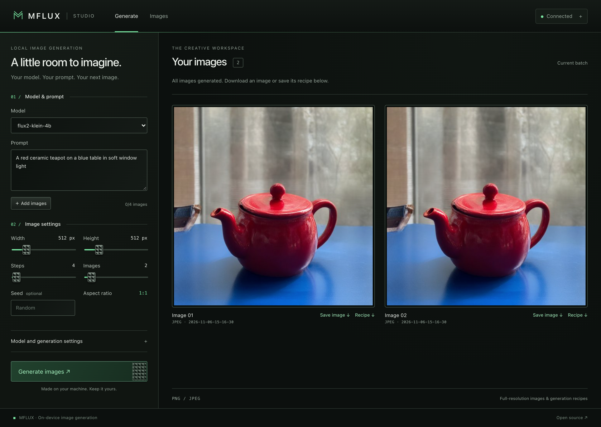
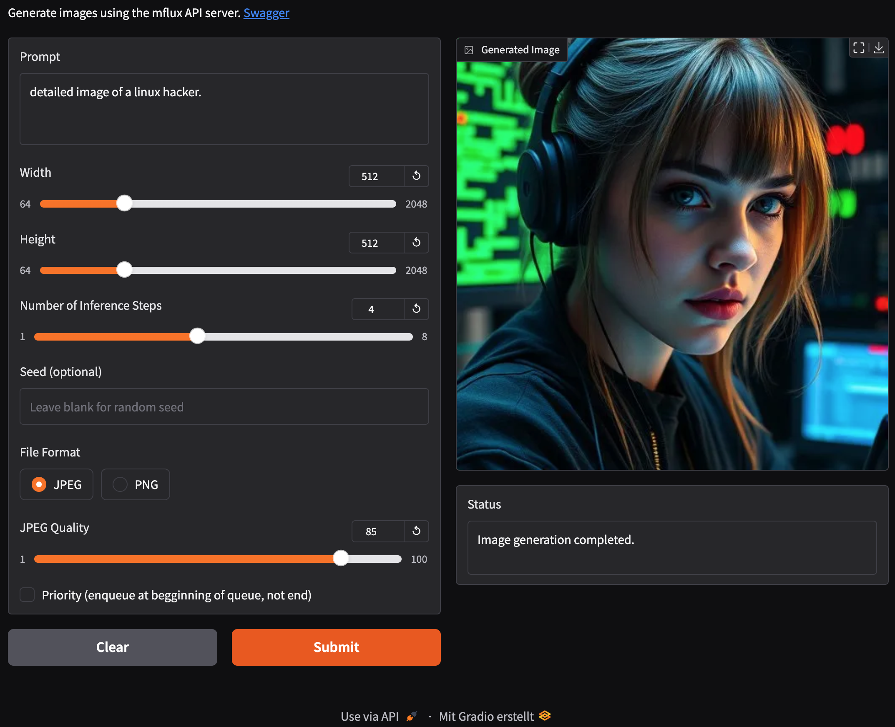

# API Server for mflux

This API server is designed for asynchronous image generation tasks with [mflux](https://github.com/filipstrand/mflux). It is particularly optimized for environments where GPU resources need to be shared across multiple tasks, such as in generative AI chat programs. This server ensures that only one image generation task runs at a time to efficiently use GPU resources. We also add a default user interface to provide a multi-image generation front-end.

## Supported models at a glance

**Default: FLUX 3 Image Klein — 16 inference steps.** Start it with
`./run.sh`, or choose any model below with `./run.sh --model NAME`.
The startup parameter also works with `.venv/bin/python3.12 server.py`.
This table covers every checkpoint registered by this server; additional
accepted names for the same checkpoints are listed just below it.

| Model / checkpoint | Startup parameter | Parameters¹ | Gated² | Default steps³ | Fast, few-step model⁴ |
| --- | --- | ---: | :---: | ---: | :---: |
| **[FLUX 3 Image Klein](https://huggingface.co/black-forest-labs/flux-3-image-klein) (default)** | `--model flux-3-image-klein` | 5.6B | Yes | **16** | No |
| [FLUX.2 Klein 4B](https://huggingface.co/black-forest-labs/FLUX.2-klein-4B) | `--model flux2-klein-4b` | 4B | No | **4** | **Yes** |
| [FLUX.2 Klein 9B](https://huggingface.co/black-forest-labs/FLUX.2-klein-9B) | `--model flux2-klein-9b` | 9B | Yes | **4** | **Yes** |
| [FIBO 2 Edit Turbo](https://huggingface.co/briaai/Fibo-2.0-edit-turbo) | `--model fibo2-edit-turbo` | 8.1B | Yes | **4** | **Yes** |
| [FLUX.1 Schnell](https://huggingface.co/black-forest-labs/FLUX.1-schnell) | `--model schnell` | 12B | Yes | **4** | **Yes** |
| [FLUX.1 Schnell, 4-bit](https://huggingface.co/dhairyashil/FLUX.1-schnell-mflux-v0.6.2-4bit) | `--model dhairyashil/FLUX.1-schnell-mflux-v0.6.2-4bit` | 12B | No | **4** | **Yes** |
| [Krea 2 Turbo](https://huggingface.co/krea/Krea-2-Turbo) | `--model krea2` | ~12B | Yes | **8** | **Yes** |
| [ERNIE-Image Turbo](https://huggingface.co/baidu/ERNIE-Image-Turbo) | `--model ernie-image-turbo` | 8B | No | **8** | **Yes** |
| [Z-Image Turbo](https://huggingface.co/Tongyi-MAI/Z-Image-Turbo) | `--model z-image-turbo` | 6B | No | **9** | **Yes** |
| [Z-Image Turbo, 4-bit](https://huggingface.co/filipstrand/Z-Image-Turbo-mflux-4bit) | `--model filipstrand/Z-Image-Turbo-mflux-4bit` | 6B | No | **9** | **Yes** |
| [Ideogram 4 FP8](https://huggingface.co/ideogram-ai/ideogram-4-fp8) | `--model ideogram4` | 9.3B per transformer¹ | Yes | 20 (preset) | No |
| [FLUX.1 Dev](https://huggingface.co/black-forest-labs/FLUX.1-dev) | `--model dev` | 12B | Yes | 25 | No |
| [FLUX.1 Dev, 4-bit](https://huggingface.co/dhairyashil/FLUX.1-dev-mflux-4bit) | `--model dhairyashil/FLUX.1-dev-mflux-4bit` | 12B | No | 25 | No |
| [FLUX.1 Krea Dev](https://huggingface.co/black-forest-labs/FLUX.1-Krea-dev) | `--model krea-dev` | 12B | Yes | 25 | No |
| [FLUX.1 Krea Dev, 4-bit](https://huggingface.co/filipstrand/FLUX.1-Krea-dev-mflux-4bit) | `--model filipstrand/FLUX.1-Krea-dev-mflux-4bit` | 12B | No | 25 | No |
| [Qwen-Image-2512](https://huggingface.co/Qwen/Qwen-Image-2512) | `--model qwen` | 20B | No | 25 | No |
| [Qwen-Image, 6-bit](https://huggingface.co/filipstrand/Qwen-Image-mflux-6bit) | `--model filipstrand/Qwen-Image-mflux-6bit` | 20B | No | 25 | No |
| [FIBO](https://huggingface.co/briaai/FIBO) | `--model fibo` | 8B | Yes | 25 | No |
| [FIBO, 4-bit](https://huggingface.co/briaai/Fibo-mlx-4bit) | `--model briaai/Fibo-mlx-4bit` | 8B | No | 25 | No |
| [FIBO, 8-bit](https://huggingface.co/briaai/Fibo-mlx-8bit) | `--model briaai/Fibo-mlx-8bit` | 8B | No | 25 | No |
| [Qwen-Image 2.1](https://huggingface.co/Qwen/Qwen-Image-2.1) | `--model qwen-image-2.1` | 7B | No | 40 | No |
| [ERNIE-Image](https://huggingface.co/baidu/ERNIE-Image) | `--model ernie-image` | 8B | No | 50 | No |
| [FLUX 3 Image Klein Base](https://huggingface.co/black-forest-labs/flux-3-image-klein-base) | `--model flux3-image-klein-base` | 5.6B | Yes | 50 | No |
| [FIBO 2 Dev](https://huggingface.co/briaai/Fibo-2.0-dev) | `--model fibo2` | 8.1B | Yes | 50 | No |
| [MOSS-Image SFT](https://huggingface.co/OpenMOSS-Team/MOSS-Image-SFT) | `--model moss-image` | 4.9B | No | 50 | No |
| [MOSS-Image Base](https://huggingface.co/OpenMOSS-Team/MOSS-Image-Base) | `--model moss-image-base` | 4.9B | No | 50 | No |
| [Anima Turbo](https://huggingface.co/circlestone-labs/Anima) | `--model anima` | 2B | See page | 10 | Yes |
| Anima Aesthetic / Base | `--model anima-aesthetic` / `anima-base` | 2B | See page | 30 | No |
| [Iris-3B Turbo](https://huggingface.co/speridlabs/iris-3b) | `--model iris-3b` | 3B | See page | 4 (fixed) | Yes |
| Iris-3B Base | `--model iris-3b-base` | 3B | See page | 100 | No |
| [Ming-Image Design](https://huggingface.co/inclusionAI/Ming-Image-0.1-Design) | `--model ming-image-design` | 6.15B | See page | 12 | No |
| [Qwen Image 2.1 Turbo](https://huggingface.co/Qwen/Qwen-Image-2.1-Turbo) | `--model qwen-image-2.1-turbo` | 7.1B | See page | 8 | Yes |
| [Qwen Image Edit 2511](https://huggingface.co/Qwen/Qwen-Image-Edit-2511) | `--model qwen-edit-2511` | 20B | See page | 40 | No |
| [Qwen 2.1 Fun ControlNet Union](https://huggingface.co/alibaba-pai/Qwen-Image-2.1-Fun-Controlnet-Union) | `--model qwen-image-2.1-controlnet` | 7.1B + control | See page | 40 | No |
| Qwen 2.1 Turbo + Fun ControlNet Union | `--model qwen-image-2.1-turbo-controlnet` | 7.1B + control | See page | 8 | Yes |
| [Krea 2 depth ControlNet](https://huggingface.co/Patil/Krea-2-depth-controlnet) | `--model krea2-controlnet` | ~12B + adapter | See page | 8 | Yes |

¹ **Parameters** are the published, rounded image-generation transformer sizes
(B = billion), excluding text/vision encoders and the VAE. They are not total
pipeline sizes or RAM requirements. Ideogram 4 uses separate positive and
negative transformer branches. Quantization reduces weight storage, not the
underlying parameter count.

² **Gated** describes the linked checkpoint repository, checked anonymously
against Hugging Face metadata and weight-file access on **22 September 2026**.
“Yes” requires access to that repository and authentication with `hf auth login`
or `HF_TOKEN`; “No” means the repository allows anonymous downloads. In
particular, the official FLUX.1 Schnell repository is gated even though its
listed 4-bit conversion is not. Access status can change and is separate from
the model's license, which is linked on its model page.
The FLUX 3 entries were added from the upstream guide on 4 November 2026;
accept the checkpoint license and authenticate before downloading them.
FIBO 2 Dev and Edit Turbo's model pages also require acceptance and login,
checked on 4 November 2026.
MOSS-Image SFT and Base's model pages are ungated, checked on 4 November 2026.

³ **Default steps** come from this server's registry, not a generic upstream
example. Override them per generation using the API's `steps` field or the
client's steps control. Ideogram 4 instead uses `preset`, defaulting to
`V4_DEFAULT_20`; its `steps` field does not override the preset.
With mflux 0.24.0, `qwen` selects Qwen-Image-2512, while the separately listed
6-bit repository contains the earlier Qwen-Image checkpoint.

⁴ **Fast, few-step model** means a model designed to generate in the listed
4–10 steps. This indicates a low-step speed advantage, not a measured ranking
across models. Actual latency also depends on model size, resolution, reference
images, guidance and hardware. The 20–50-step entries are not few-step models,
even when they benefit from caching. Quantization does not guarantee a speedup.

### Additional accepted model names

Use any name in the right column as the value of `--model` (or the API's
`model` field). These aliases have the same parameters, gating and defaults as
their corresponding row above. `/api/ls` returns the complete live registry.

| Model name above | Additional accepted names |
| --- | --- |
| `flux2-klein-4b` | `black-forest-labs/FLUX.2-klein-4B` |
| `flux2-klein-9b` | `black-forest-labs/FLUX.2-klein-9B` |
| `flux-3-image-klein` | `flux3-image-klein`, `flux3-klein`, `flux3`, `black-forest-labs/flux-3-image-klein` |
| `flux3-image-klein-base` | `flux3-klein-base`, `flux3-base`, `flux-3-image-klein-base`, `black-forest-labs/flux-3-image-klein-base` |
| `fibo2` | `fibo-2.0-dev`, `briaai/Fibo-2.0-dev` |
| `fibo2-edit-turbo` | `fibo-2-edit-turbo`, `fibo-2.0-edit-turbo`, `briaai/Fibo-2.0-edit-turbo` |
| `moss-image` | `moss-image-sft`, `moss`, `OpenMOSS-Team/MOSS-Image-SFT` |
| `moss-image-base` | `moss-base`, `OpenMOSS-Team/MOSS-Image-Base` |
| `krea2` | `krea-2`, `krea-2-turbo`, `krea/Krea-2-Turbo` |
| `ernie-image-turbo` | `baidu/ERNIE-Image-Turbo` |
| `ernie-image` | `baidu/ERNIE-Image` |
| `qwen-image-2.1` | `qwen-2.1`, `qwen-image-21`, `Qwen/Qwen-Image-2.1` |
| `ideogram4` | `ideogram-4-fp8`, `ideogram-ai/ideogram-4-fp8` |
| `anima` | `anima-turbo`, `circlestone-labs/Anima` |
| `iris-3b` | `iris-3b-turbo`, `iris-turbo`, `iris`, `speridlabs/iris-3b` |
| `iris-3b-base` | `iris-base` |
| `ming-image-design` | `ming-image`, `ming-design`, `ming`, `inclusionAI/Ming-Image-0.1-Design` |
| `qwen-image-2.1-turbo` | `qwen-2.1-turbo`, `qwen-image-21-turbo`, `qwen-image-turbo-21`, `Qwen/Qwen-Image-2.1-Turbo` |
| `qwen-edit-2511` | `qwen-image-edit-2511`, `Qwen/Qwen-Image-Edit-2511` |
| `qwen-image-2.1-controlnet` | `qwen-image-2.1-controlnet-union`, `qwen-2.1-controlnet`, `alibaba-pai/Qwen-Image-2.1-Fun-Controlnet-Union` |
| `qwen-image-2.1-turbo-controlnet` | `qwen-image-2.1-turbo-controlnet-union`, `qwen-2.1-turbo-controlnet` |
| `krea2-controlnet` | `krea-2-controlnet-depth`, `krea-2-controlnet`, `Patil/Krea-2-depth-controlnet` |

## Examples

Here are two different client applications that use the server API. The default web frontend, **MFLUX Studio**, is available at `http://localhost:4030`. Its self-contained, classless HTML interface uses dark surfaces, fresh green accents and subtle metal grips. Generation controls sit beside the image gallery on desktop and stack on mobile. Two progress bars track the complete batch and the current image. Each image has paired image/recipe download links; the header's connection control holds the server address and API documentation link.



The second screenshot shows the Gradio Front-End:



Code for both client applications is located in the `clients` subdirectory.

## Features

The API supports features such as:

- Queuing of image generation tasks.
- Immediate worker wakeup for queued generations and model loads, without the
  former one-second polling delay. GPU requests still run one at a time.
- Forecasting computation time for better user experience in multi-user environments.
- Managing task statuses and retrieving generated images.
- Reporting failed tasks without stopping the worker or retrying them automatically.

Furthermore, the API exposes a swagger endpoint to self-document the server.

## Example usage

Use Python 3.12. The server dependencies in `requirements.txt` pin
`mflux==0.24.0` and require `mlx>=0.32.2,<0.33.0` and
`protobuf>=4.25.0,<8.0`.

Install the dependencies in a virtual environment:

```sh
python3.12 -m venv .venv
source .venv/bin/activate
python3.12 -m pip install -r requirements.txt
```

For gated Hugging Face models, obtain access to the model repository and log in
with `hf auth login`, or set `HF_TOKEN`. The Hugging Face CLI is installed with
the server dependencies. Authentication is separate from starting the server.

```sh
python3.12 server.py --quantize 8 --host 0.0.0.0
```

The default model is `flux-3-image-klein`, with 16 inference steps and guidance
1.0. Select another model with `--model`; `/api/ls` lists supported model names
and defaults, and `/api/ps` reports the current settings. Without `--host`, the
server listens on `127.0.0.1`.

Plain `./run.sh` uses `flux-3-image-klein` with no
quantization; `--quantize 4`, `5`, `6` or `8` remains optional where supported (Iris accepts 4/8).

Alternatively, `./run.sh --quantize 8` creates or reuses `.venv`, upgrades the
dependencies within the requirements constraints, and starts the server on
`0.0.0.0`. It requires Python 3.12 and does not perform Hugging Face login.

### Loading options, capabilities and saved checkpoints

`GET /api/info` and each entry of `/api/ls` describe `load_options`,
`generation_options`, `quantization`, `schedulers`, step limits, fixed steps,
dimension alignment, RGBA output, masks and control inputs. Explicit unsupported
options return HTTP 400. The web frontend builds its controls from this data,
including step limits beyond 50 and model-specific quantization choices.

Invalid options return HTTP 400, gated access returns 401, and an unavailable
Hugging Face repository or pinned revision returns 503 with the upstream error.
A failed reload keeps the previous loaded model and options. The server does
not silently switch to an unpinned revision.

Load options belong to the model and require reloading its weights:

```json
{"model":"flux2-klein-4b","quantize":6,"options":{
  "small_text_encoder":true,"small_decoder":true,"compute_precision":"float16"
}}
```

Send that object to `POST /api/load`. The same options have startup flags:
`--small-text-encoder`, `--small-decoder`, `--compute-precision float16`,
`--vae-full-precision`, `--text-encoder-quantize 5`, `--qwen21-backend legacy`,
and `--controlnet-path PATH`. Check `/api/info` for which model accepts each.
`bfloat16` selects native compute; float16 changes only the supported internal
compute path. Smaller encoders are experimental and can change prompt following.
`vae_full_precision` uses the full image and requires more memory than the native
row-strip decode. These are optional settings; the default native paths remain.

Use `--lora PATH` repeatedly and one `--lora-scale NUMBER` per adapter, or
`options.lora_paths` and `options.lora_scales` arrays. Scales default to 1.
`--bake-lora` / `--no-bake-lora` (`options.bake_lora`) override the model's
native policy; MOSS keeps adapters separate by default. Load compatible
step-distilled LoRAs before using their shorter schedules.

For local models or third-party prequantized repositories, select the family
explicitly. The stored precision is retained when `quantize` is omitted:

```sh
./run.sh --model /path/to/flux3-klein-q4 --base-model flux3 --models-dir /path/to/models
```

```json
{"model":"mflux-community/anima-aesthetic-mflux-q4","base_model":"anima-aesthetic"}
```

Local directories must pass upstream `mflux-check` package validation before
loading. `POST /api/check` accepts `model` and optional `base_model` for a
read-only local/cache check; it never downloads or repairs files. `GET /api/saved`
lists packages under `--models-dir` or `MFLUX_MODELS_DIR`, also suggested in the
web frontend's custom-model field. A custom package needs a complete model,
including the components required by its family.

### Editing and acceleration controls

`POST /api/generate` accepts optional `mask_image`, `control_image` and
`depth_image` using the same base64/data-URL encoding as `init_image`.
Mask images must match the source size; white regenerates and black keeps the
source. They require one source image and are supported by FIBO 2, native Qwen
2.1 and Qwen ControlNet. Qwen ControlNet accepts a structural `control_image`
and per-request `controlnet_strength`; it also inpaints with source + mask.
Krea depth ControlNet accepts `depth_image`, or one photograph in `init_image`
to estimate depth with Depth Pro. Krea's `controlnet_strength` is a **load
option**, because native mflux merges the control deltas before quantization.

Native Qwen 2.1 accepts `strength` in (0,1], `auto_mask` (an object description),
`enhance_prompt`, `verify`, `verify_retries` (0–10), `output_resolution`,
`use_kv_cache`, `use_step_cache` and `step_cache_threshold`. Step reuse needs
the prefix cache. The small text encoder cannot auto-mask, rewrite or verify.

FIBO 2 and MOSS accept `step_cache_ratio` in (0,1); FIBO 2 and Ideogram accept
`cfg_end` in (0,1]. FIBO also accepts `render_text_images`; MOSS accepts an
`uncond_skip_layers` integer array, with `[]` disabling the native layer skip.
Supported sampler choices are listed per model. Approximate acceleration is
opt-in and can change the image; short runs may skip no steps by upstream design.

### Generation recipes

`GET /api/recipe?task_id=...` returns a versioned JSON recipe containing the
load configuration, generation options, seed, runtime cache flags, model revision pins and input
pixel hashes. Retrieve it before `/api/image` deletes the task. PNG files also
embed it as `mflux_recipe`; the web frontend offers a JSON download.
Uploaded images are normalized for EXIF orientation before hashing and queuing.
Replay by loading `recipe.load` through `/api/load` and submitting
`{"recipe": RECIPE}` to `/api/generate`. Supply the original source/mask/control
images again; recipes contain hashes rather than image data. A changed model,
load option or input is rejected. Unknown revision pins are recorded as null;
local and unpinned third-party files must be kept unchanged for reproducibility.
Replay requires the same mflux version and runtime cache flags; numerical results
can still vary with hardware. Effective rewritten prompts are recorded separately.
All queued requests fail clearly if their loaded model/options change before
execution. Raw image data is excluded from `/api/tasks` and recipes.

The Python client accepts `--load load.json`, `--options generation.json`,
`--mask-image FILE`, `--control-image FILE`, `--depth-image FILE`, and
`--recipe-output recipe.json`. Replay with `--recipe recipe.json` and the
original input files after loading the recipe's model configuration. Use an
output extension that matches the recipe's format; generation options can
explicitly override the format and other recorded parameters.

### Native Qwen Image 2.1 and the new 0.24 models

Qwen Image 2.1 now loads mflux's native `QwenImage21Edit` for text-to-image and
up to ten ordered reference images. It supports RGBA output, native prefix KV
caching, quantized text/vision weights, masks, edit strength, automatic masks,
prompt enhancement and verification. Dimensions must be multiples of **32**;
steps must be at least two. Its defaults remain 40 steps and guidance 1.0.
PNG is now the default for Qwen 2.1, Qwen ControlNet and Ming to preserve alpha;
explicit JPEG requests composite alpha on white.

`qwen-image-2.1-turbo` selects the actual Turbo checkpoint and its native
8-node schedule, with guidance fixed at 1.0. This is separate from running the
base checkpoint with a distilled LoRA and `scheduler: "viggle_turbo"` (six steps).
The legacy custom Qwen adapter remains available for comparisons through
`--qwen21-backend legacy`; it does not support Turbo, small encoders or advanced
editing controls. `--no-qwen21-context-cache` disables the selected backend's
prefix cache. Historical measurements below used the old adapter on mflux 0.20
and are not performance claims for the native 0.24 path.
The native editor changes conditioning, decoding and quantization, so the same
seed can produce a different image from the legacy adapter. The native path
adds editing features and lowers quantized memory use; it is not uniformly
faster.

Anima has Turbo (`anima`, 10 steps/guidance 1), Aesthetic and Base (30 steps/
guidance 4). Iris generates pixels without a VAE: Turbo always uses four steps
and guidance 1; Base defaults to 100 steps/guidance 3. Ming defaults to 12 steps,
guidance 1 and RGBA output; `--text-encoder-quantize` controls its encoder
separately. Qwen Edit 2511 needs one to three references and defaults to 40
steps/guidance 4. All model aliases and live options are available from `/api/ls`.

Use `--model anima-aesthetic`, `iris-3b`, `iris-3b-base`, `ming-image-design`,
`qwen-edit-2511`, `qwen-image-2.1-turbo`, `qwen-image-2.1-controlnet`,
`qwen-image-2.1-turbo-controlnet`, or `krea2-controlnet`. Native mflux aliases
are accepted too. Iris/Anima/Ming are text-to-image only.

The following quantization measurements describe the **legacy mflux
0.20 adapter**. It downloaded approximately 33 GB and kept its text encoder in
bf16. The native 0.24 editor quantizes text/vision components too, so its memory
and timing behavior differs.

**Measured quantization performance (22 September 2026):** on an Apple M1 Ultra
with 64 GiB unified memory, **bf16 was fastest in every tested workload**.
The table shows median generation times from three runs after warmup, using
mflux 0.20.0 and MLX 0.32.2, 12 steps, seed 42, guidance 1.0, and context caching
enabled. Encoding and decoding are included; model loading, HTTP, queueing and
file writes are excluded. Inputs were identical across precisions, with prompt
caches cleared before each run.

| Workload | bf16 (default) | Q8 | Q4 |
| --- | ---: | ---: | ---: |
| 512×512 text-to-image | **15.50 s** | 18.22 s | 18.43 s |
| 1024×1024 text-to-image | **68.26 s** | 76.22 s | 77.41 s |
| 512×512, two-reference edit | **17.59 s** | 19.72 s | 20.24 s |

Q8 took approximately 12–18% longer and Q4 13–19% longer. At 1024×1024,
peak allocated MLX memory was **43.02 GiB (bf16), 36.81 GiB (Q8), and
33.49 GiB (Q4)**. These figures include resident model tensors, but are not
whole-process memory or minimum RAM requirements.

In that legacy setup, unquantized bf16 was fastest and Q8/Q4 saved memory.
The server retains its unquantized default; these older measurements do not
establish the fastest precision for the native 0.24 editor. Results may differ
on other hardware or under memory pressure, and these 12-step tests do not
replace the recommended 40-step quality setting.

### Image inputs and multi-image editing

`POST /api/generate` accepts an ordered `init_images` array of base64 images or
`data:image/...;base64,...` URLs. All inputs contribute to **one output image**.
The existing `init_image` field accepts the same encodings for a single input.
An empty array, omitted inputs, or an empty/null `init_image` means text-to-image.
Do not combine a nonempty `init_images` array with a nonempty `init_image`.

`GET /api/info` reports the selected model, quantization, default steps/guidance,
and `edit`, `multi_image_edit`, and `max_init_images`. The same capability fields
are included for each model in `/api/ls`. `edit` includes ordinary single-image
img2img; only `multi_image_edit` indicates joint reference conditioning.

| Model | Maximum inputs | Input behavior |
| --- | ---: | --- |
| FLUX.2 Klein 4B / 9B, including repository-name aliases | 4 | Native reference-conditioned editing |
| FLUX 3 Image Klein / Base, including all aliases | 10 | Native reference-conditioned editing |
| FIBO 2 Dev / Edit Turbo, including all aliases | 5 | Native reference-conditioned instruction editing |
| Qwen Image 2.1, including all aliases | 10 | Ordered reference-conditioned instruction editing |
| Other existing img2img models | 1 | Ordinary img2img, strength 0.4 |
| Ideogram 4 and MOSS-Image SFT / Base | 0 | Text-to-image only |
| Anima, Iris-3B and Ming | 0 | Text-to-image only |
| Qwen Image Edit 2511 | 3 | Requires one to three references |
| Qwen 2.1 ControlNet | 1 | Source + mask for inpainting; separate optional control image |
| Krea depth ControlNet | 1 | Photograph for depth estimation, or separate prepared depth map |

FLUX.2 Klein now uses mflux's native `Flux2KleinEdit` adapter for text-to-image
and reference editing. Single inputs also use reference conditioning, without
the former img2img strength of 0.4. Its distilled defaults remain 4 steps and
guidance 1.0. Four references is this server's limit. Qwen Image 2.1 exposes
`edit: true`, `multi_image_edit: true`, and `max_init_images: 10` in `/api/info`
and the model catalog. The web and Gradio clients use these capabilities for
their add/remove controls and attachment counters. Restart an already running
server after updating; refresh the client to fetch the new capabilities.

For example, start `./run.sh --model flux2-klein-4b --quantize 8` and submit:

```json
{
  "prompt": "Place the object from image 1 on the table in image 2.",
  "init_images": ["BASE64_OBJECT_IMAGE", "BASE64_TABLE_IMAGE"],
  "seed": "42",
  "format": "PNG"
}
```

Replace the placeholders with encoded image data. Invalid image data, conflicting
fields, and unsupported image counts return HTTP 400 before anything is queued.
Each decoded image retains its position in the array. The worker processes all
references together, removes temporary files on success or failure, and releases
input image data after processing. `/api/tasks` exposes `init_image_count` but
omits image data. `/api/status` and `/api/image` work as before. If the model or
quantization changes before an image-input task runs, that task reports an error
and must be resubmitted. PNG preserves any output alpha; JPEG composites it onto
white. This does not add transparency support to models that only output RGB.

Both GUI clients offer a compact **+ Images** control and a filename list with
individual removal. The web UI also provides small reorder arrows and a Clear
action; Gradio uses removable filename chips. Uploads are disabled while model
capabilities are unavailable, when the model does not accept images, or when its
limit is reached. Existing attachments remain removable after switching models;
generation is blocked until any excess attachments are removed. The web UI
refreshes `/api/info` on model/server changes and window focus; Gradio refreshes
every ten seconds and has a Refresh button. Both recheck before image submission.
Gradio's blank Steps field uses the server default.
The web UI's Count control requests separate outputs using the same inputs. The
Python test client reads local files and checks `/api/info` before submission:

```sh
.venv/bin/python3.12 clients/python/mflux_client.py \
  --prompt "Place the object from image 1 on the table in image 2." \
  --init-images object.png table.png --seed 42 --output edit.png
```

Omit `--steps` to use the selected model's default. All API routes retain the
`/api` prefix. The factory image script also accepts `--init-images FILE ...`,
reusing those inputs for each prompt and validating support before submission.

### FLUX.2 Klein 4B performance

FLUX.2 Klein 4B runs native mflux denoising with three server optimizations:
repeated-prompt encoding reuse, reference VAE encoding reuse, and reuse of
native prediction functions (compiled on supported Apple chips). These are
enabled for `flux2-klein-4b` and `black-forest-labs/FLUX.2-klein-4B` and listed
in `/api/info` under `inference_optimizations`.

The prompt and reference caches each retain at most 16 entries and 128 MiB of
tensor payload; backing buffers/runtime overhead are additional. Reference
keys use the actual preprocessed pixels, so temporary filenames do not prevent
hits and changed image content does not reuse stale latents. Reference order
and positional IDs are still handled by native mflux. Prediction-function reuse
is limited to four input signatures. All caches belong to the loaded model.

The four-step scheduler, precision, native transformer and VAE output are
preserved. The regular 4B checkpoint does **not** use prefix KV caching.
Compilation follows upstream's hardware policy, including compilation on
M1/M2 Max and Ultra. Use `--no-flux2-optimizations` to compare native execution
without encoder/predictor caches. Both paths normalize absent reference inputs
to empty tensors, fixing text-only generation through mflux 0.20's edit adapter.

The largest expected saving is for repeated prompts or reference images.
Fresh inputs still require their encoders.
On an M1 Ultra at BF16/four steps, repeated-input medians improved by about
3–8% across the measured 512px/1024px text and two-reference cases. Fresh-input
inference showed no consistent speedup. All 29 native/optimized comparisons
produced identical final latents and images. Queue-wakeup savings are additional
and are not included in these inference measurements.

### MOSS-Image

MOSS-Image uses the native implementation in `mflux==0.24.0`. Start SFT with:

```sh
./run.sh --model moss-image --quantize 8
```

Use `--model moss-image-base` for Base. All names in the alias table also work
with `POST /api/load`, for example `{"model": "moss-image", "quantize": 8}`,
and appear in `/api/ls` and the web frontend. Quantization is optional; the
server CLI accepts 4, 5, 6 or 8 bits where supported. Both checkpoints initially download about
27 GB of weights before optional quantization. The official repositories are
ungated and use Apache 2.0.

Both variants default to **50 steps, guidance 3.0 and 1024×1024**. The server
uses the native training-grid schedule and negative-branch layer skip (layer
22). Width and height must be positive multiples of 16. Steps must produce
distinct training-grid points: the native scheduler accepts **1–218 steps**.
Invalid dimensions, step counts or seeds return HTTP 400 before queuing.

Use the existing `/api/generate` → `/api/status` → `/api/image` workflow:

```sh
curl http://localhost:4030/api/generate -H 'Content-Type: application/json' \
  -d '{"prompt":"A fluffy cat on a wooden bench in golden evening light","seed":"42","format":"PNG"}'
```

Natural-language prompts, tag sequences and JSON layouts all pass through
unchanged; encode a JSON layout as a string in `prompt`. The existing
`negative_prompt` field is forwarded, defaulting to empty conditioning in
mflux. The negative branch runs when `guidance` differs from 1.0; setting it
to 1.0 disables that pass.

Both checkpoints are text-to-image only. `/api/info` reports `edit: false`,
`multi_image_edit: false` and `max_init_images: 0`; nonempty `init_image` or
`init_images` inputs return HTTP 400. The clients disable image attachments.
LoRAs are load options; `step_cache_ratio` and `uncond_skip_layers` are supported generation options. See the
[MFLUX MOSS-Image guide](https://github.com/mflux-community/mflux/blob/main/src/mflux/models/moss_image/README.md)
for model details and layout examples.

### FIBO 2

FIBO 2 uses the native implementation in `mflux==0.24.0`. Start Dev with:

```sh
./run.sh --model fibo2 --quantize 8
```

Use `--model fibo2-edit-turbo` for the distilled editing checkpoint. All names
in the alias table also work with `POST /api/load`, for example
`{"model": "fibo2-edit-turbo", "quantize": 8}`, and appear in `/api/ls` and
the web frontend. Quantization is optional; the CLI accepts 4, 5, 6 or 8 bits where supported.

Dev defaults to **50 steps and guidance 5.0**. Edit Turbo defaults to
**4 steps and guidance 1.0**, which disables the negative pass. Following mflux,
the server also accepts text-to-image requests with Edit Turbo, although Bria
presents that checkpoint for editing. Both default to **1024×1024**, including
edits; the server always supplies the output dimensions. Width and height must
be multiples of 16 between 16 and 8192, steps must be at least 1, and the seed
must be an integer. Invalid values return HTTP 400 before queuing.

The API's `prompt` remains a string: use plain text or a JSON caption encoded
as a string. FIBO 2 prompts pass directly to mflux, which handles caption
formatting and native text rendering. For example:

```sh
curl http://localhost:4030/api/generate -H 'Content-Type: application/json' \
  -d '{"prompt":"A snowy owl on a mossy branch in a misty pine forest at dawn","seed":"42","format":"PNG"}'
```

For editing, provide one to five ordered base64 references in `init_images`,
or one in the legacy `init_image` field, and write an instruction such as
`Make the bicycle blue`. Refer to multiple inputs as `<image_1>`, `<image_2>`,
and so on. JSON edit prompts require an `edit_instruction` string and may
include a `structured_caption` describing the result. Malformed JSON captions,
invalid caption field types, and JSON edits without an instruction return
HTTP 400 before queuing; unknown or missing caption fields remain upstream
warnings. Native editing conditions fresh noise without an img2img strength.
`/api/info` reports `edit: true`, `multi_image_edit: true`, and
`max_init_images: 5` for both checkpoints.

The existing `negative_prompt` field overrides mflux's default negative
conditioning when `guidance` is greater than 1. Omit it to retain the native
text-to-image or edit default. At guidance 1 or below, it has no effect.
FIBO 2 accepts `mask_image`, `step_cache_ratio`, `cfg_end` and `render_text_images`. LoRAs are model-load options. Automatic FIBO-vlm prompt expansion is not part of the generation API.

Accept the terms on the checkpoint's Hugging Face page and run `hf auth login`
or set `HF_TOKEN` before loading. Each checkpoint initially downloads about
25.5 GB before optional quantization. See the
[MFLUX FIBO 2 guide](https://github.com/mflux-community/mflux/blob/main/src/mflux/models/fibo2/README.md)
for caption formats and editing examples. Retrieve results through the usual
`/api/status` and `/api/image` workflow.

### FLUX 3 Image Klein

FLUX 3 uses the native implementation in `mflux==0.24.0`. Update an existing
environment with `.venv/bin/python3.12 -m pip install -r requirements.txt`, then
start the distilled checkpoint with:

```sh
./run.sh --model flux3 --quantize 8
```

Use `--model flux3-base` for the undistilled Base checkpoint. All names in the
alias table work with `POST /api/load`, for example
`{"model": "flux3", "quantize": 8}`, and appear in `/api/ls` and the web
frontend's model selector. Quantization is optional; the CLI accepts 4, 5, 6 or 8
bits and otherwise keeps the native weights.

The distilled checkpoint defaults to **16 steps** and ignores `guidance`.
Base defaults to **50 steps and guidance 3.5**, using two transformer passes
per step. Both default to **1024×1024**; the server always supplies its output
dimensions, including for edits. Width and height must be positive multiples
of 16, steps must be at least 1, and the seed must be an integer. Nonempty
`negative_prompt` values are unsupported and return HTTP 400 before queuing.

Use the normal `/api/generate` → `/api/status` → `/api/image` workflow for
text-to-image. For editing or composition, provide one to ten ordered base64
references in `init_images`, or one reference in the legacy `init_image` field.
The server reuses the loaded weights for both native generation paths.
References condition fresh noise without an img2img strength. `/api/info`
reports `edit: true`, `multi_image_edit: true`, and `max_init_images: 10` for
both checkpoints. For edits, write a full caption of the intended result.

Before the first download, accept the license on the checkpoint's Hugging Face
page and run `hf auth login` or set `HF_TOKEN`. Each checkpoint downloads about
20 GB before optional quantization. See the
[MFLUX FLUX 3 guide](https://github.com/mflux-community/mflux/blob/main/src/mflux/models/flux3/README.md)
for model details and prompt examples. LoRAs are model-load options; automatic prompt upsampling is not exposed.

### Krea 2 Turbo

Krea 2 Turbo uses mflux's dedicated `Krea2` loader and defaults to 8 steps,
guidance 1.0, and mflux's `er_sde` sampler.
Select it explicitly with `--model krea2`,
`--model krea-2`, `--model krea-2-turbo`, or `--model krea/Krea-2-Turbo`:

```sh
./run.sh --model krea2 --quantize 8
```

These names also work with `POST /api/load`, for example
`{"model": "krea2", "quantize": 8}`, and appear in the web frontend's model
selector. Generate through `/api/generate` with a plain text prompt; omitted
`steps` and `guidance` use the Turbo defaults. The existing base64 `init_image`
input enables image-to-image generation with the server's fixed strength of 0.4.
See the [MFLUX Krea 2 guide](https://github.com/mflux-community/mflux/blob/main/src/mflux/models/krea2/README.md)
for upstream model details.

The server prepares text fusion/projection once per request, reuses positional
frequencies, passes grouped K/V heads directly to Metal attention, and applies
the final output projection only to image tokens. All denoising steps and the
native sampler, guidance, img2img and VAE remain intact. This is invariant
conditioning reuse, not a text-prefix KV cache: Krea's joint text/image states
still change at every step. Prepared positive/negative branches are isolated
and released on success or failure. Repeated-prompt embeddings use a model-owned
LRU cache limited to 16 entries and 256 MiB of tensor payload; request geometry
has a 64 MiB tensor budget. These budgets exclude backing-buffer and runtime
overhead. Oversized cache entries are computed normally without retention.

These optimizations are enabled by default. Use `--no-krea2-optimizations` for
the native denoising path; the prompt-cache memory bound still applies.
`/api/info` lists the enabled changes in `inference_optimizations`.
Compilation follows upstream's hardware policy (disabled on M1/M2 variants
other than Max/Ultra), with
request conditioning passed as explicit inputs. Quantization remains optional;
the Qwen quantization timings above do not establish the fastest Krea precision.
For classifier-free guidance, use `guidance` greater than 1 and optionally
`negative_prompt`; this requires a second transformer pass per step.

A reduced random transformer took 16–24% less time on this M1 Ultra;
**these are not real Krea image-generation speedups**. Full-checkpoint benchmarking is pending because
the gated Hugging Face download returned HTTP 401 in this environment.

The first load downloads the Krea weights (about 33 GB, including the text encoder
and VAE), even when quantization is enabled. Existing cached files are reused.
Before loading Krea, the server completes its Hugging Face snapshot, including
`turbo.safetensors` and tokenizer files that may be missing from an earlier
download with another loader. There is no need to delete the cache.

### Ideogram 4

Ideogram 4 is supported by the pinned `mflux==0.24.0` dependency. Start it with
`--model ideogram4`, `--model ideogram-4-fp8`, or
`--model ideogram-ai/ideogram-4-fp8`:

```sh
python3.12 server.py --model ideogram4 --quantize 4 --host 0.0.0.0
```

Before the first load, request access to
[ideogram-ai/ideogram-4-fp8](https://huggingface.co/ideogram-ai/ideogram-4-fp8),
wait for approval, and authenticate with `hf auth login` or set `HF_TOKEN`.
The initial FP8 checkpoint download is about 28 GB, even when using quantization.
Omit `--quantize` to use the original FP8 layout; `--quantize 4` and
`--quantize 8` enable MLX quantization.

You can also switch a running server with
`POST /api/load` and `{"model": "ideogram4", "quantize": 4}`. The model is
listed by `/api/ls` and in the web frontend's model selector.

Generation uses `preset` to select the sampler:

| Preset | Steps |
| --- | --- |
| `V4_DEFAULT_20` (default) | 20 |
| `V4_QUALITY_48` | 48 |
| `V4_TURBO_12` | 12 |

For this model, `steps` and `guidance` are ignored so that the preset's guidance
and noise schedules are preserved. Width and height must be multiples of 16
between 256 and 2048. Image-to-image input (`init_image`) is unsupported and
returns HTTP 400.

The API's `prompt` remains a string. Plain text works, but structured JSON
captions are recommended; encode the caption as a JSON string:

```python
import json
import requests

caption = {
    "high_level_description": "A white ceramic teapot on a simple studio table.",
    "compositional_deconstruction": {
        "background": "A neutral tabletop with a pale wall behind it.",
        "elements": [
            {"type": "obj", "bbox": [250, 320, 780, 690],
             "desc": "A glossy white ceramic teapot with a curved handle."}
        ],
    },
}
response = requests.post("http://localhost:4030/api/generate", json={
    "prompt": json.dumps(caption, ensure_ascii=False),
    "seed": "42",
    "width": 1024,
    "height": 1024,
    "preset": "V4_DEFAULT_20",
    "strict_caption_validation": True,
    "format": "PNG",
})
response.raise_for_status()
task_id = response.json()["task_id"]
```

Use the usual `/api/status` and `/api/image` workflow to retrieve the result.
`strict_caption_validation` defaults to false; enabling it rejects caption
warnings with HTTP 400 before queuing. See the
[MFLUX Ideogram 4 guide](https://github.com/mflux-community/mflux/blob/main/src/mflux/models/ideogram4/README.md)
for the caption format and more examples. In the web frontend, paste the JSON
caption into the prompt box; generation uses the default 20-step preset.

### API workflow

The server runs on port 4030 by default. Host and port can be configured with
`--host` and `--port`; run `python3.12 server.py --help` for all options.
To see the swagger documentation, open `http://localhost:4030/swagger`

To produce an image, the usual workflow is:

- `/api/generate` to initialize the generation, this returns a `task_id`
- `/api/status` to poll for `waiting`, `done`, or `error`; waiting tasks include an estimated remaining time and a progress snapshot
- `/api/image` to retrieve the produced image as soon as the status turns to "done"

In detail - here is a call to generate an image:

```sh
curl -X 'POST' \
  'http://localhost:4030/api/generate' \
  -H 'accept: application/json' \
  -H 'Content-Type: application/json' \
  -d '{
  "prompt": "A beautiful landscape",
  "seed": "1725311496",
  "height": 1024,
  "width": 1024,
  "format": "JPEG",
  "quality": 85,
  "priority": false
}'
```

Omit `steps` and `guidance` to use the selected model's defaults. The initial
estimate is 120 seconds per 1024×1024 image, scales with image area and queued
work, and adapts as generations complete. An example response for the first
task with the default model and `--quantize 8` is:

```json
{
  "task_id": "1fc9cc4f",
  "task_length": 0,
  "expected_time_seconds": 120.0,
  "model": "flux-3-image-klein",
  "quantize": 8
}
```

The `task_id` can then be used to check the image generation status:

```sh
curl -X 'GET' \
  'http://localhost:4030/api/status?task_id=1fc9cc4f' \
  -H 'accept: application/json'
```

An example response is:

```json
{
  "pos": 0,
  "status": "waiting",
  "wait_remaining": 15,
  "progress": {
    "phase": "sampling",
    "step": 8,
    "total_steps": 16,
    "fraction": 0.475,
    "attempt": 1,
    "sampling_fraction": 0.5,
    "elapsed_seconds": 12.0,
    "remaining_seconds": 12.0,
    "iterations_per_second": 0.6666666667,
    "seconds_per_step": 1.5,
    "sampling_stats": "50% · 8/16 [00:12<00:12,  1.50s/it]"
  }
}
```
The image is expected to be ready in 15 seconds. Position 0 means that no other
pending task precedes it. Completed and failed tasks do not count toward the
position or estimated waiting time.

`progress.phase` is `queued`, `preparing`, `sampling`, `finishing`, `done`, or
`error`. `step` and `total_steps` describe the actual sampling pass, including
shorter image-to-image loops. Native progress reporting supplies a `fraction` from 0 to
0.95 while sampling; decoding, verification and encoding finish the task.
Only a ready image has fraction 1. Unknown work has a null fraction, including
preparation, models without callback reporting and additional verification
passes (`attempt` increases for those passes). This fraction measures completed
work stages rather than elapsed time.

`sampling_fraction` is the native log's sampling percentage as a value from 0 to
1. `elapsed_seconds`, `remaining_seconds`, `iterations_per_second` and
`seconds_per_step` come from the same progress display and smoothed rate as the
console; `remaining_seconds` is an estimate. `sampling_stats` formats the
percentage, completed/total steps, elapsed/remaining time and `s/it` or `it/s`
using the native log formatter. These fields are null until available.
Counters update when the native log updates, after completed sampling work,
without extra GPU synchronization. Models that disable the native display fall
back to callback counts and elapsed time. Sampling values reset for each pass
and remain at their final values during decoding and encoding; they exclude
those finishing stages.

The web frontend combines completed images with the current image's partial
progress for its batch bar, which reaches 100% only after retrieving all images.
The current-image bar matches the native sampling percentage and shows
`sampling_stats`, for example `50% · 8/16 [00:12<00:12,  1.50s/it]`. It reaches
100% when sampling ends, then shows the finishing/saving state while retaining
the sampling time. Unknown stages and older servers use an indeterminate bar;
older servers with step reporting retain their step-based display. One batch
runs at a time per page; errors leave the batch incomplete and unlock its
controls. Restart an existing server and refresh the page after updating to
enable the sampling counters and timing.

If generation fails, `/api/status` returns HTTP 200 with `status: "error"`, an
`error` message and `progress.phase: "error"`. Stop polling that task and display
the error. Failed tasks are not retried and do not delay subsequent tasks; they can
be removed with `GET /api/cancel?task_id=...` or `GET /api/clear` (all tasks).
Generation and image encoding exceptions mark the task as failed; cleanup
exceptions are logged without changing a successfully generated result.
In either case, the worker continues with the next pending task. The web,
Gradio, and Python clients stop polling on `error`. An unknown task ID returns
HTTP 404.

Finally, the image can be retrieved with:

```sh
curl -X 'GET' \
  'http://localhost:4030/api/image?task_id=1fc9cc4f' \
  -H 'accept: application/json'
```

This returns the jpeg binary and removes the image from the production queue.

There are more API endpoints to list the queue and delete entries from the queue, see swagger documentation for details.

## Python client (quick example)

Here are three functions which implement a client endpoint for the image generation process as shown above with curl:

```python
import time
from io import BytesIO

import requests
from PIL import Image


def mflux_generate_client(mfluxendpoint, prompt, width=1280, height=720, steps=None, seed=None, format="JPEG", quality=85, priority=False):
    data = {
        "prompt": prompt,
        "height": height,
        "width": width,
        "format": format,
        "quality": quality,
        "priority": priority
    }
    if steps is not None:
        data["steps"] = steps
    if seed is not None:
        data["seed"] = str(seed)
    response = requests.post(mfluxendpoint + "/api/generate", json=data)
    response.raise_for_status()
    # parse the response and get the task_id
    json = response.json()
    task_id = json["task_id"]
    return task_id
    
def mflux_status_ready(mfluxendpoint, task_id):
    response = requests.get(mfluxendpoint + "/api/status?task_id=" + task_id)
    response.raise_for_status()
    result = response.json()
    if result["status"] == "done":
        return 0
    if result["status"] == "error":
        raise RuntimeError(result.get("error", "Image generation failed."))
    return max(result.get("wait_remaining", 1), 1)

def mflux_get_image(mfluxendpoint, task_id):
    response = requests.get(mfluxendpoint + "/api/image?task_id=" + task_id + "&base64=false&delete=true")
    response.raise_for_status()
    return response.content
```

The mfluxendpoint would be a string like `http://localhost:4030`. 
A single function which uses the client endpoints above to get an image can be i.e.:

```python
def generate_image(mfluxendpoint, prompt, width=1280, height=720, steps=None):
    startt = time.time()
    task_id = mflux_generate_client(mfluxendpoint, prompt, width=width, height=height, steps=steps)
    for i in range(10000):
        waiting_time = mflux_status_ready(mfluxendpoint, task_id)
        print("Waiting time: ", waiting_time, " seconds")
        if waiting_time == 0: break
        nextsleep = max(min(waiting_time / 4, 10), 1)
        time.sleep(nextsleep)
    else:
        raise TimeoutError("Image generation did not finish within the polling limit.")
    imageb = mflux_get_image(mfluxendpoint, task_id)    
    stopt = time.time()
    print("Time taken: ", stopt - startt, " seconds")
    image = Image.open(BytesIO(imageb))
    return image
```

## Dependency check

Check the installed server dependencies in the project virtual environment:

```sh
.venv/bin/python3.12 -m pip check
```

Install the Gradio client in its own Python 3.12 environment: current Gradio
requires Pillow below 13 while mflux 0.24 requires Pillow 13. Do not install
client requirements into the server venv.

## License

The server code is licensed under the Apache 2.0 license.

## Contribution and Contact

Pull requests to enhance the code are welcome!

If you want to share your experience with mflux-server on social media, please notify me under one of the following addresses:

- Mastodon: `@orbiterlab@sigmoid.social`
- X: `@orbiterlab`
