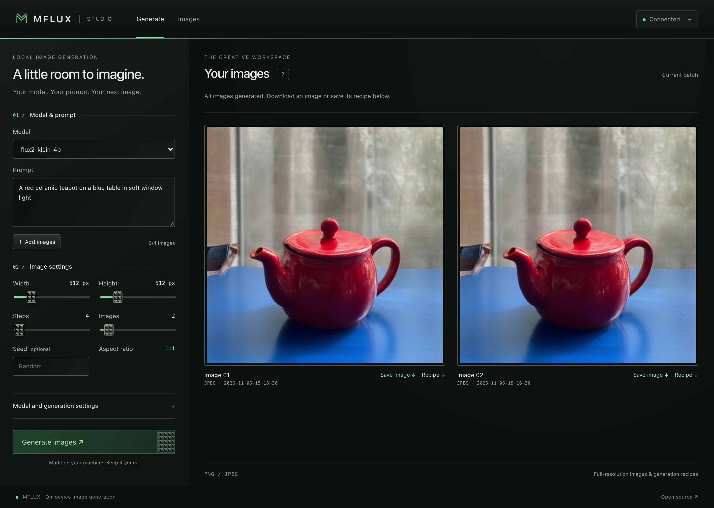

# mflux Image Generator Front-end

MFLUX Studio is the built-in browser interface for `mflux-server`. A dark, photography-inspired workspace pairs compact generation controls with a full-resolution image gallery. Fresh green accents, fine borders and subtly textured button/slider grips keep the interface quiet and precise.

## Features

- **Multi-Image Generation**: Generate several outputs through sequential requests using the Images control.
- **Two Progress Bars**: **All images** combines completed images with progress on the active image and reaches 100% after all images are retrieved. **Current image** matches the console's sampling percentage and displays steps, elapsed time, estimated remaining time and speed (`s/it` or `it/s`). It reaches 100% when sampling ends, retaining the final timing while the image finishes and saves. Preparation and unknown work use an indeterminate bar; additional sampling passes show their own percentage and timing. One batch runs at a time per page; failures stop it, preserve completed images and unlock the controls.
- **Classless Styling**: Semantic HTML elements provide the layout and styling. Static markup and dynamically created settings, attachments and image cards have no CSS classes. Everything is self-contained in `index.html`, including the small vector icons and CSS grip texture; no fonts, stylesheets or image assets are fetched externally.
- **Responsive Workspace**: Controls and images sit side by side on desktop and stack on narrow screens. Keyboard focus, live generation status, explicit labels and reduced-motion preferences are supported.
- **Image Inputs**: The compact **＋ Add images** button adds files below the prompt. A numbered filename list offers small reorder arrows, individual × buttons, and Clear. Each request sends an ordered `init_images` array for one output.
- **Model Support**: `/api/info` controls whether adding images is enabled and how many may be attached. Uploads are disabled while support is unknown, for models without image input (including MOSS-Image SFT/Base and Ideogram 4), and at the limit. Model/server changes and window focus refresh capabilities; submission checks again. If a model switch makes existing attachments invalid, remove them before generating. FLUX.2 Klein supports up to four references; FIBO 2 Dev and Edit Turbo support up to five; FLUX 3 Image Klein (including Base) and Qwen Image 2.1 accept up to ten ordered references. Refer to the numbered attachment list in your prompt, using `<image_1>`, `<image_2>`, etc. for FIBO 2, or “image 1”, “image 2”, etc. for Qwen. Restart an older server to expose the updated limit.
- **Convenient Image Download**: Each image card pairs **Save image** and **Recipe** download links. Select the preview to open the full-resolution image in a new tab. File extensions match PNG/JPEG output.
- **Model Settings**: Expand **Model and generation settings** for capability-driven guidance, samplers, quantization, LoRAs, smaller encoders/decoders, masks, control images and optional acceleration. Loading settings reloads the model; generation settings apply to the next request. Fixed samplers disable their step slider, and other models expose their actual step limits.
- **Saved Models and Recipes**: Enter a saved directory or HF repository and select its family with the model selector. Packages under the configured models directory appear as suggestions. Each completed generation offers a recipe JSON download before its queue entry is removed; PNG files also embed the recipe.
- **Collision-Free Naming**: Images are saved with unique, timestamped filenames to prevent filename collisions, enabling smooth handling of large image sets.

## Installation

1. Ensure you have a running instance of `mflux-server`. The front-end requires this server to handle image generation requests.
2. No additional installation is needed for the front-end. Simply double-click `index.html` to open it in your browser.

## Usage

1. Enter a prompt and configure the parameters (image dimensions, quality, and other settings).
2. Click **Generate images** to start the image generation process.
3. Once generated, each image appears with a download button, allowing for quick saving.

Restart the server and refresh the page after updating for native sampling
counters and timing. A caption such as `50% · 8/16 [00:12<00:12,  1.50s/it]`
uses the same elapsed time, estimated remaining time and rate as the console
log. The bar follows completed iterations, independently of elapsed time;
decoding and encoding are separate finishing stages. Older servers remain
usable with step-based or indeterminate current-image progress. Progress
respects reduced-motion preferences.

## Requirements

- `mflux-server` running on a specified endpoint (default is `http://localhost:4030`).

## Getting Started

1. Ensure the `mflux-server` is running and accessible.
2. Open the `index.html` file in your browser.
3. Customize your settings and start generating images!

## Customization

You can change the server address in the header. The address is also saved locally for convenience.
Open **Server connection** in the header to change the server address or open its API documentation. The connection indicator reflects whether `/api/info` is reachable.

The classless stylesheet at the top of `index.html` uses element selectors and a few state attributes. Its `:root` variables control the palette (`--accent` is fresh green), surfaces and grip pattern. Element IDs are retained as JavaScript and accessibility hooks. The gallery shows the current batch rather than a persistent library; save images and recipes before starting the next batch or leaving the page.

## License

This project is licensed under the Apache License 2.0.
